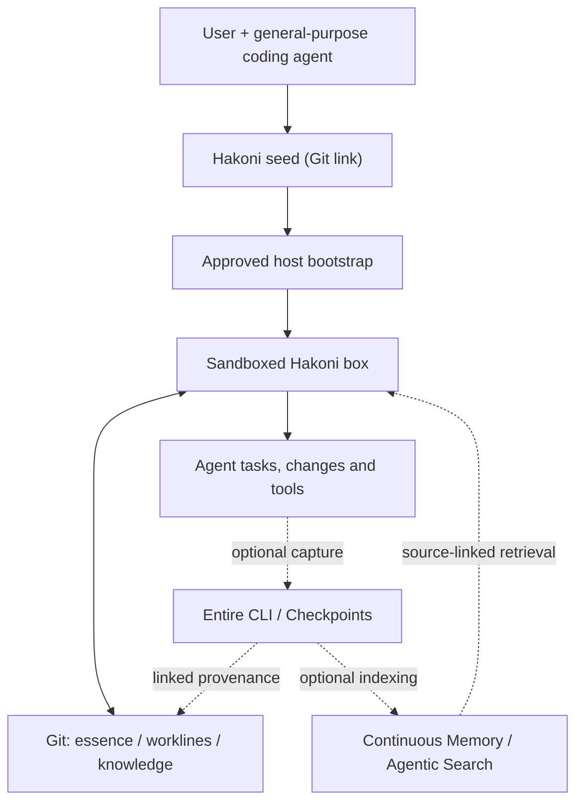

# Entire — Agent-native Git and implications for Hakoni

> Technology watch · 26 November 2026  
> Research note, **not an architecture decision**. Public information and hypotheses are separated below. Entire has not been installed or tested inside Hakoni.

## Executive summary

[Entire](https://entire.com/) develops an agent-oriented Git development workflow: capturing sessions and code-change provenance, making project context recoverable, and exploring a Git forge designed for humans and coding agents. The company was founded by former GitHub CEO Thomas Dohmke in 2026. Its [open-source CLI](https://github.com/entireio/cli) is the most relevant starting point for practical investigation.

The overlap with Hakoni is **Git as a durable collaboration and context layer**, not simply a place to store source code. The difference is the delivery unit:

- **Entire:** infrastructure around code, agent work, checkpoints, memory, search, review and Git hosting.
- **Hakoni:** a **small, sandboxed agentic work environment** delivered from a single onboarding link, with tools, skills, instructions, permissions, persistence and collaboration conventions. The target includes non-developers.

Potential relationship: Entire-like capture and search could become an optional provenance/memory service **used by a Hakoni**, not a replacement for Hakoni's sandbox or distribution model.

## 1. Entire's offering — capability map

| Area | Reported capability | Relevance to Hakoni |
| --- | --- | --- |
| **Entire CLI / Checkpoints** | Record coding-agent sessions and connect their activity to Git changes. | Recover what happened and why; complement curated workline logs. |
| **Session provenance** | Link prompts, tool usage, generated changes and session summaries to commits/checkpoints. | Traceability during agent hand-offs and investigations. |
| **Continuous Memory** | Reuse historical development context across agent sessions. | Reduce onboarding repetition; **do not** confuse recorded history with accepted decisions. |
| **Agentic Search** | Query code and related development context, potentially using iterative investigation. | Retrieve *why* a change happened without replaying every transcript. |
| **Code graph** | Explore relationships and structure in a codebase. | Potentially useful for coding agents; not equivalent to knowledge of a business workflow. |
| **Git forge / review workflow** | Agent-oriented Git hosting and review concepts, including Trails. | A possible collaboration substrate, not a Hakoni requirement. |
| **Agent identity** | Emerging ways to distinguish autonomous agents as principals. | Worth evaluating against scoped credentials and sandbox access policies. |

These are product descriptions, not claims that all features are open source, generally available, or available without Entire's service. Confirm versions, licenses and interfaces before any integration.

### Checkpoints versus workline logs

An execution trace, a commit, a project decision and a reusable memory item serve **different purposes**:

1. **Raw agent session:** rich evidence, high volume and potentially sensitive.
2. **Checkpoint/commit attribution:** the link between a change and its provenance.
3. **Distilled memory:** useful context to recover later, with confidence and source links.
4. **Accepted project knowledge:** authoritative instructions, policies, skills and decisions.

Hakoni already has curated documentation and a logbook. Automatic capture could complement it, but should never silently overwrite authoritative instructions or publish private session content.

## 2. Comparison against Hakoni

Hakoni's [README](../README.md) identifies the **seed** (one Git onboarding link), **box** (sandbox), **Git** (recipe, knowledge and collaboration) and interchangeable **agent**. The [vision](../worklines/first_step/docs/0000_01_vision.md) distinguishes a reusable *essence*, an installed *instance* and individual *persistence*.

| Dimension | Entire | Hakoni |
| --- | --- | --- |
| Main question | How should Git workflows and repositories evolve for coding agents? | How can someone receive, run and grow a useful agentic environment from one link? |
| Git | Code + agent session provenance / search / review. | Recipe + work plan + knowledge + contribution and continuity substrate. |
| Environment | Tooling around agent-assisted development. | Sandboxed container is foundational. |
| User | Primarily software development teams. | Also non-technical people using specialised agentic packages. |
| Distribution | Git platform and CLI. | Bootstrap instructions, reproducible package and explicit installation approval. |
| Memory | Captured session context and searchable history. | Versioned shared knowledge; raw versus distilled memory remains a design question. |
| Security boundary | Access controls on tooling, agents and repositories. | Explicit host/bootstrap versus sandbox trust boundary and provider permissions. |

**Important:** Entire does **not** replace the Hakoni box. Conversely, Hakoni should not reinvent a developer forge if one can serve as an optional backend.

## 3. A possible integration boundary

Dashed connections are **proposals, not implemented interfaces**.

Potential benefit: a fresh agent joining a Hakoni workline could ask what was attempted, what changed, why a decision was made and where supporting evidence lives, instead of reloading an ever-growing transcript. The agent would still use versioned Hakoni instructions as the authority.

## 4. Critical constraints for Hakoni

- **Private by default.** Agent transcripts may contain credentials, local paths, tool results and sensitive content. Hakoni's public *essence* must never receive such information accidentally.
- **Separate lifetimes and ownership.** Shared reference knowledge, local/personal memory, raw session telemetry and short-lived tokens require distinct storage, retention and access policies.
- **Git portability.** A seed should still work using standard Git and an interchangeable coding agent if Entire is absent.
- **Scoped permissions.** A sandbox should not obtain broad repository tokens or unrestricted outbound traffic merely to enable checkpoints.
- **No hidden dependency.** An optional capture/indexing layer must not make a one-link installation less reproducible or harder to explain.
- **Truth and authority.** An agent's retrospective account is evidence, not necessarily a validated reason for a code change.
- **Outside coding.** Hakoni should investigate whether session capture generalises to business tasks (reporting, investigation, domain procedures), rather than assuming code-specific signals will transfer.

## 5. Suggested research and experiments (not authorised implementation work)

| Priority | Experiment | What to measure |
| --- | --- | --- |
| P0 | Inspect the open-source Entire CLI and its checkpoint/commit data format in a throwaway fictional repository. | Portability, readable metadata, dependencies, retention. |
| P0 | Threat-model session capture in a sandbox with synthetic secrets. | What can leave the box, what reaches a Git remote, redaction and opt-out. |
| P1 | Compare a Claude Code → Codex hand-off using Hakoni workline docs alone versus docs plus indexed checkpoints. | Correct resumption, context lost, setup steps, time and tokens. |
| P1 | Try branch changes, rebase, squash and work with no commits. | Provenance continuity and failure modes. |
| P1 | Explore **private** provenance storage alongside a public package repository. | Isolation between public essence and personal persistence. |
| P2 | Answer “why was this changed?” with curated logbook, Git history and agentic search. | Evidence quality and unsupported interpretations. |
| P2 | Assess whether Entire components could be optional tools in a Hakoni image. | Additional complexity, permissions, resource usage. |

**Suggested first move:** inspect formats and local behavior before adopting another forge, enabling automatic uploads or changing Hakoni's architecture. Use synthetic data and an isolated test repository.

## 6. Questions worth keeping open

1. Can a checkpoint be attached to a workline independently of a Git commit?
2. Can a project restart without Entire's hosted service and still interpret the record?
3. Can public project instructions and private session telemetry be safely separated?
4. What is the minimum concise, verifiable hand-off format between different coding agents?
5. Who decides which retrieved memories are useful, current and trustworthy?
6. Do the capture and search tools work for non-code business-agent workflows?
7. Does Entire improve a one-link Hakoni setup enough to justify another dependency?
8. How do provider identity, local sandbox policy and Git permissions interact?

## 7. Access points and references

**Official / primary entry points:**

- Entire product and company: https://entire.com/
- Entire source organisation: https://github.com/entireio
- Open-source Entire CLI: https://github.com/entireio/cli
- Entire documentation (follow current links from the product homepage and CLI README): https://docs.entire.com/
- Entire engineering posts: https://entire.com/blog
- Entire company announcements: https://entire.com/news

**Hakoni sources used for the comparison:**

- [README — project orientation](../README.md)
- [Vision and open questions](../worklines/first_step/docs/0000_01_vision.md)
- [Agent rules](../AGENTS.md)
- [Logbook](LOGBOOK.md)

External source pages and product claims can change; follow the official release and CLI documentation when testing. Specific marketing performance claims should not be treated as independently validated Hakoni outcomes.

## Conclusion

**Entire signals an important industrial shift:** Git-based development is accumulating agent provenance, searchable intent and persistent context. Hakoni has a related but distinct product thesis: **a small, distributable, sandboxed agentic environment that starts from a single link**.

The most promising intersection is an optional **provenance and searchable memory layer** that helps agents resume and collaborate while preserving Hakoni's separate, explicit trust boundary. Evaluate such a layer empirically; do not conflate it with the box itself.
